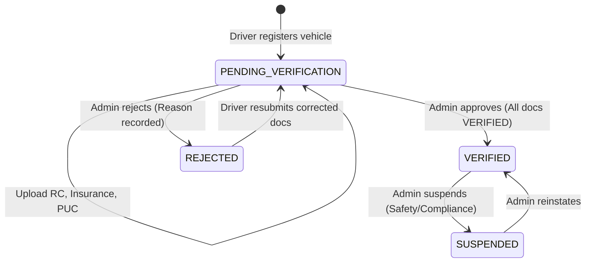

# LEXOR — Vehicle Microservice (Spring Boot)

## Overview

The **Vehicle Microservice** is a core fleet component of the **LEXOR AI-Powered Smart Mobility Platform**. It manages vehicle registration, regulatory compliance document verification (Registration Certificate, Insurance, Pollution Under Control, etc.), administrative fleet approvals, vehicle lifecycle transitions, and driver-vehicle assignments.

Operating on **port 8087**, the service integrates with the shared `lexor_db` MySQL database and enforces strict role-based access control (RBAC) via JSON Web Tokens (JWT) aligned with the LEXOR Auth and Driver Services.

---

## Architecture & Key Features

1. **Role-Based Security & Driver Ownership Isolation**:
   - Only authenticated users with `ROLE_DRIVER` can register, inspect, update, and manage vehicles.
   - Driver identity is derived exclusively from the validated JWT subject and underlying driver profile—drivers cannot assign vehicles to other accounts via request fields.
   - Cross-driver access is prevented with HTTP 403 Forbidden responses.
   - Administrators (`ROLE_ADMIN`) have fleet-wide visibility and exclusive review/decision rights.
   - Riders (`ROLE_RIDER`) are barred from fleet administration.

2. **Deterministic Vehicle Lifecycle & State Transitions**:
   - Verification States: `PENDING_VERIFICATION`, `VERIFIED`, `REJECTED`, `SUSPENDED`.
   - Distinct operational status (`isActive`) and driver assignment state (`ACTIVE`, `INACTIVE`, `TERMINATED`).
   - Resubmission workflow for rejected vehicles and documents.
   - Mandatory document compliance checks before a vehicle can be submitted or approved.
   - Suspension cascades to deactivate operational readiness and driver assignments.

3. **Secure Document Storage & Inspection**:
   - Multipart file uploads with configurable size limits (`MAX_FILE_SIZE=10MB`, `MAX_REQUEST_SIZE=15MB`).
   - Magic bytes / content-signature verification (PDF, JPEG, PNG, WEBP) protecting against file spoofing.
   - Path traversal prevention ensuring all stored files remain within the configured directory.
   - UUID-based filesystem naming outside the web root.
   - No direct URL file access; all downloads are authenticated and authorization-verified.
   - Document versioning on replacement/resubmission with immutable audit logs.
   - Internal filesystem paths and credentials are never exposed in API responses.

4. **Normalized Registration & Fleet Integrity**:
   - Automated license plate normalization (e.g. `ka 01 eq 4829` $\to$ `KA-01-EQ-4829`).
   - Uniqueness enforcement for active registration numbers and vehicle VINs.
   - Audit trail for administrative decisions (`vehicle_verification_history`) and driver assignments (`driver_vehicle_assignments`).

---

## Technology Stack

- **Java**: 21 (LTS)
- **Framework**: Spring Boot 3.2.5
- **Build Tool**: Apache Maven 3.9+
- **Persistence**: Spring Data JPA & Hibernate 6.4 (runtime `ddl-auto=validate`)
- **Database**: MySQL 8.0+ (shared `lexor_db`)
- **Security**: Spring Security 6 with JJWT 0.12.5 (HMAC-SHA256)
- **Validation**: Jakarta Bean Validation (Hibernate Validator)
- **API Documentation**: Springdoc OpenAPI 2.5.0 (Swagger UI)
- **Testing**: JUnit 5, Spring Security Test, MockMvc, and H2 (MySQL Mode)

---

## Prerequisites

- **Java JDK 21** installed and configured (`JAVA_HOME` pointing to JDK 21).
- **Maven 3.9+** installed (`mvn -version`).
- **MySQL Server 8.0+** running locally or in Docker on port 3306 with `lexor_db` initialized.
- Existing migrations `V1__init_schema.sql`, `V2__seed_data.sql`, and `V3__driver_service_additive.sql` applied.

---

## Database Migration Requirements

The vehicle service introduces additive schema updates in migration script `V4__vehicle_service_additive.sql`.

### Migration Details:
- **File:** `database/mysql/migrations/V4__vehicle_service_additive.sql`
- **Canonical Schema:** Reflected in `database/mysql/schema.sql` (Tables 5, 27, 28, 29).
- **Changes**:
  - Adds `uuid`, `fuel_type`, `verification_status`, `rejection_reason`, `reviewed_by_admin_id`, and `verified_at` to `vehicles`.
  - Creates table `vehicle_documents` for regulatory compliance uploads and versioning.
  - Creates table `vehicle_verification_history` for administrative audit trails.
  - Creates table `driver_vehicle_assignments` for fleet assignment linkages.

### Manual Application (Developer Guide):
To review and apply migration V4 manually to your local MySQL instance:

```bash
# Apply using MySQL Command Line Client:
mysql -u root -p lexor_db < database/mysql/migrations/V4__vehicle_service_additive.sql
```

*Note: In production and test environments, `spring.jpa.hibernate.ddl-auto` is set to `validate`, ensuring Spring Boot strictly verifies schema compatibility without issuing destructive DDL operations.*

---

## Environment Variables Configuration

Copy `.env.example` to `.env` or set environment variables in your environment:

| Variable | Default Value | Description |
| :--- | :--- | :--- |
| `PORT` | `8087` | Server HTTP port |
| `DB_HOST` | `localhost` | MySQL host address |
| `DB_PORT` | `3306` | MySQL port |
| `DB_NAME` | `lexor_db` | Shared MySQL database name |
| `DB_USERNAME` | `root` | Database username |
| `DB_PASSWORD` | `21011017` | Database password |
| `JWT_SECRET` | `404E6352...` | 256-bit secret key for HMAC-SHA |
| `LEXOR_JWT_SECRET` | `404E6352...` | Fallback secret matching LEXOR conventions |
| `JWT_EXPIRATION_MS`| `86400000` | Token expiration (24 hours in ms) |
| `STORAGE_LOCATION` | `uploads/vehicle-documents` | Directory for uploaded documents |
| `ALLOWED_EXTENSIONS`| `pdf,jpg,jpeg,png,webp` | Whitelisted file extensions |
| `REQUIRED_DOCUMENTS`| `REGISTRATION_CERTIFICATE,VEHICLE_INSURANCE,POLLUTION_UNDER_CONTROL` | Mandatory compliance documents |
| `MAX_FILE_SIZE` | `10MB` | Maximum size for an uploaded document |
| `MAX_REQUEST_SIZE`| `15MB` | Maximum size for a multipart request |

---

## Running the Service

### 1. Build & Run via Maven:
```bash
cd backend/springboot/vehicle-service
mvn clean package -DskipTests
java -jar target/vehicle-service-1.0.0-SNAPSHOT.jar
```

Or run directly with Spring Boot plugin:
```bash
mvn spring-boot:run
```

The service will start on port **8087**:
- Base API URL: `http://localhost:8087`
- Swagger UI Documentation: `http://localhost:8087/swagger-ui.html`
- OpenAPI Specification: `http://localhost:8087/v3/api-docs`

---

## API Endpoints Reference

### 1. Driver Operations (`/api/v1/vehicles`)
*All driver operations require `Authorization: Bearer <JWT>` with `ROLE_DRIVER`.*

| Method | Endpoint | Description |
| :--- | :--- | :--- |
| `POST` | `/api/v1/vehicles` | Register a new vehicle |
| `GET` | `/api/v1/vehicles` | List all vehicles owned by authenticated driver |
| `GET` | `/api/v1/vehicles/{vehicleUuid}` | Get vehicle details (enforces ownership) |
| `PUT` | `/api/v1/vehicles/{vehicleUuid}` | Update permitted vehicle details |
| `PATCH` | `/api/v1/vehicles/{vehicleUuid}/status` | Toggle operational active/inactive status |
| `POST` | `/api/v1/vehicles/{vehicleUuid}/submit-verification`| Submit vehicle and documents for review |
| `GET` | `/api/v1/vehicles/{vehicleUuid}/verification-status` | Get verification checklist and missing requirements |
| `GET` | `/api/v1/vehicles/{vehicleUuid}/verification-history`| View audit decisions on this vehicle |
| `GET` | `/api/v1/vehicles/{vehicleUuid}/assignments` | View driver assignment history |

### 2. Vehicle Document Operations (`/api/v1/vehicles/{vehicleUuid}/documents`)
*Requires `ROLE_DRIVER` and ownership of the vehicle.*

| Method | Endpoint | Description |
| :--- | :--- | :--- |
| `POST` | `/api/v1/vehicles/{vehicleUuid}/documents` | Upload compliance document (multipart) |
| `GET` | `/api/v1/vehicles/{vehicleUuid}/documents` | List current compliance documents |
| `GET` | `/api/v1/vehicles/{vehicleUuid}/documents/{documentId}` | Get document metadata |
| `GET` | `/api/v1/vehicles/{vehicleUuid}/documents/{documentId}/download` | Stream and download file binary |
| `POST` | `/api/v1/vehicles/{vehicleUuid}/documents/{documentId}/resubmit` | Resubmit corrected document |
| `DELETE` | `/api/v1/vehicles/{vehicleUuid}/documents/{documentId}` | Soft-delete an unverified document |

### 3. Administrator Fleet Management (`/api/v1/admin/vehicles`)
*All admin operations require `Authorization: Bearer <JWT>` with `ROLE_ADMIN`.*

| Method | Endpoint | Description |
| :--- | :--- | :--- |
| `GET` | `/api/v1/admin/vehicles` | Paginated fleet list with search and filters |
| `GET` | `/api/v1/admin/vehicles/pending` | List vehicles pending verification |
| `GET` | `/api/v1/admin/vehicles/{vehicleUuid}` | Detailed vehicle review payload |
| `GET` | `/api/v1/admin/vehicles/{vehicleUuid}/documents` | Review all submitted documents |
| `GET` | `/api/v1/admin/vehicles/{vehicleUuid}/documents/{documentId}/download`| Securely download document as admin |
| `PATCH` | `/api/v1/admin/vehicles/{vehicleUuid}/documents/{documentId}/review` | Approve/reject individual document |
| `PATCH` | `/api/v1/admin/vehicles/{vehicleUuid}/verification` | Approve or reject vehicle |
| `PATCH` | `/api/v1/admin/vehicles/{vehicleUuid}/suspension` | Suspend or reinstate vehicle |
| `GET` | `/api/v1/admin/vehicles/{vehicleUuid}/verification-history` | View verification audit log |
| `POST` | `/api/v1/admin/vehicles/{vehicleUuid}/assignments` | Assign an eligible driver to vehicle |
| `DELETE` | `/api/v1/admin/vehicles/{vehicleUuid}/assignments/{assignmentId}` | Terminate active driver assignment |
| `GET` | `/api/v1/admin/vehicles/{vehicleUuid}/assignments` | View complete assignment history |

---

## Step-by-Step Lifecycle Workflow



1. **Driver Registration**: Driver registers vehicle (`POST /api/v1/vehicles`). Vehicle is assigned initial status `PENDING_VERIFICATION`.
2. **Document Upload**: Driver uploads `REGISTRATION_CERTIFICATE`, `VEHICLE_INSURANCE`, and `POLLUTION_UNDER_CONTROL` via multipart POST. Magic bytes are checked.
3. **Submit Verification**: Driver checks checklist (`GET .../verification-status`) and submits (`POST .../submit-verification`).
4. **Administrative Review**: Admin reviews documents individually (`PATCH .../documents/{id}/review`).
5. **Vehicle Decision**:
   - If all required documents are verified, admin marks vehicle `VERIFIED`.
   - If any document is deficient, admin marks vehicle `REJECTED` with a required explanation.
6. **Fleet Assignment**: Admin assigns a verified driver (`POST .../assignments`). Only verified vehicles and verified drivers are eligible.

---

## Automated Tests

Run the complete automated test suite with Maven:

```bash
cd backend/springboot/vehicle-service
mvn test
```

Tests run in complete isolation using an in-memory H2 database (`MODE=MySQL`) and temporary directories for document uploads, without impacting `lexor_db`.
