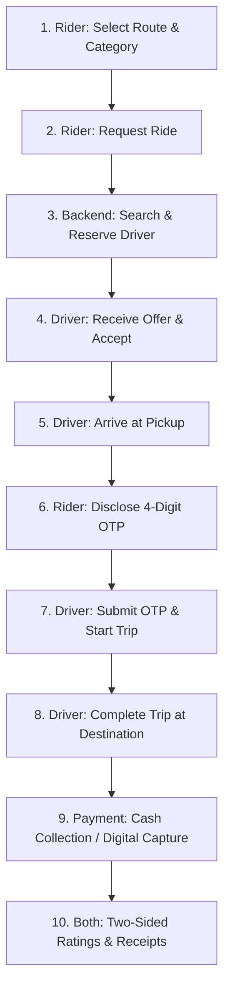

# LEXOR — End-to-End Testing & Verification Runbook

## 1. Overview
This runbook provides the test execution procedures, automated test suite verification evidence, and interactive multi-portal validation instructions for the complete LEXOR ride lifecycle integration (Phase 18).

---

## 2. Automated Test Execution Commands

### 2.1 Frontend Test Suites (Vitest)
```bash
cd frontend
npm test
```
**Actual Verification Results**:
- **Test Files**: 6 passed (6)
  - `src/test/RealtimeAndMapIntegration.test.ts` (10 tests passed)
  - `src/test/DriverTripLifecycle.test.tsx` (4 tests passed)
  - `src/test/RiderBooking.test.tsx` (4 tests passed)
  - `src/test/App.test.tsx` (3 tests passed)
  - `src/test/ExternalProviderIntegration.test.ts` (9 tests passed)
  - `src/test/SecurityAndRoleGuards.test.tsx` (3 tests passed)
- **Total Tests**: 33 passed, 0 failed.

### 2.2 .NET Microservice Test Suites (`dotnet test`)
```bash
# Booking Service
cd backend/dotnet/booking-service
dotnet test

# Payment Service
cd backend/dotnet/payment-service
dotnet test

# Driver Matching Service
cd backend/dotnet/driver-matching-service
dotnet test
```
**Actual Verification Results**:
- **Booking Service**: 50 passed, 0 failed.
  - Lifecycle tests: `BookingWorkflowEndToEndIntegrationTests.cs` (Happy path, OTP lockout, concurrent driver claim, cancellation, and arrival).
  - Security tests: `BookingControllerSecurityTests.cs` (Role guards and cross-user isolation).
- **Payment Service**: 13 passed, 0 failed.
  - Razorpay order creation, tokenized validation, cash collection ledger entries, refund requests, and HMAC webhook signature checks.
- **Driver Matching Service**: 26 passed, 0 failed.
  - Scoring policy, geo-distance ranking, vehicle category filtering, and location freshness SLA.

### 2.3 Spring Boot Microservice Test Suites (`mvn test`)
```bash
# Booking Service
cd backend/springboot/booking-service
mvn test

# Payment Service
cd backend/springboot/payment-service
mvn test

# Driver Matching Service
cd backend/springboot/driver-matching-service
mvn test
```
**Actual Verification Results**:
- **Booking Service**: 48 passed, 0 failed (`BookingWorkflowEndToEndIntegrationTest.java`).
- **Payment Service**: 13 passed, 0 failed (`PaymentServiceIntegrationTest.java`).
- **Driver Matching Service**: 28 passed, 0 failed (`MatchingControllerSecurityIntegrationTest.java`, `ScoringPolicyServiceTest.java`).

---

## 3. End-to-End Interactive Verification Scenario

Follow these steps to manually verify the ride lifecycle across portals:



### Step 1: Driver Portal Setup
1. Log in to the Driver portal (`/driver`) using a verified driver account (e.g. `vikram.singh@lexor.mobility`).
2. Verify onboarding shows `VERIFIED` and approved vehicle (`Toyota Hyryder, KA-01-EQ-4829`).
3. Click **"GO ONLINE"**. The duty toggle switches to online and starts emitting device geolocation updates every 6s.

### Step 2: Rider Portal Booking
1. Log in to the Rider portal (`/rider`) as `rajesh.kumar@lexor.mobility`.
2. Enter pickup (`Indiranagar 100ft Road`) and destination (`Prestige Tech Park, Marathahalli`).
3. Select ride category (`LEXOR Go`). The estimated upfront fare displays `₹340`.
4. Click **"Request GO"**.
5. The portal transitions to **"Searching for Driver..."** with real-time dispatch status.

### Step 3: Driver Offer & Acceptance
1. On the Driver portal, an incoming offer modal appears with a 15-second radial countdown timer.
2. Click **"ACCEPT RIDE"**.
3. The atomic claim succeeds; the driver view transitions to pickup navigation.
4. On the Rider portal, the driver card updates with Vikram Singh's details, vehicle plate, and current ETA.

### Step 4: Driver Arrival & Start OTP
1. On the Driver portal, click **"ARRIVED AT PICKUP"**.
2. The Rider portal updates to `DRIVER_ARRIVED` and prominently displays the 4-digit **Start Ride OTP** (e.g. `4829`).
3. On the Driver portal, click **"VERIFY OTP & START TRIP"**.
4. Test invalid OTP guard: Enter `0000`. The server rejects with `400 Bad Request`.
5. Enter valid OTP `4829`. The server validates BCrypt hash, marks `IN_PROGRESS`, and initiates trip progress navigation.

### Step 5: Trip Completion & Payment
1. On the Driver portal, click **"COMPLETE TRIP"**.
2. The final trip metrics record actual distance (`7.6 km`) and duration (`24 mins`).
3. For cash collection: Driver clicks **"CONFIRM CASH COLLECTION"**. The backend writes financial ledger entries (`Commission liability` and `Driver cash retained`).
4. On the Rider portal, click **"View Detailed Receipt"** to inspect the itemized invoice breakdown (`RCP-...`).

### Step 6: Two-Sided Feedback
1. Rider submits 5-star rating with compliment tag `[Clean Vehicle, Smooth Driving]`.
2. Driver rates the passenger `5 ★`.
3. Ratings persist into `feedback` table and update driver rolling average.

### Step 7: Admin Operations Verification
1. Log in as an Administrator (`/admin`).
2. Navigate to **Rides & Bookings** (`/admin/rides-bookings`): Inspect the completed ride, verified OTP timestamp, route, and financial fare.
3. Navigate to **Payments & Ledger** (`/admin/payments`): Verify the cash transaction and ledger balance.
4. Navigate to **Audit Logs** (`/admin/audit-logs`): Verify immutable audit trail records for the session.

---

## 4. Edge Case & Failure Mode Matrix

| Scenario | Trigger / Test | Expected Authoritative Result | Verified |
| :--- | :--- | :--- | :--- |
| **No Drivers Available** | Rider books in area without online drivers | Rider receives clear notification: *"No eligible drivers currently online or available nearby."* with options to retry or cancel. No fabricated mock drivers. | **YES** |
| **Unverified Driver** | Driver with pending KYC toggles online | Backend rejects with `400 / 403`. Frontend displays verification requirement; duty remains offline. | **YES** |
| **Brute Force OTP** | Driver enters wrong OTP 3 consecutive times | Booking transitions to locked status (`409 Conflict`); driver cannot start trip. | **YES** |
| **Offer Contention** | Two drivers attempt to accept same offer simultaneously | First driver claims trip atomically; second driver receives `409 Conflict` and modal dismisses. | **YES** |
| **Mid-Trip Cancellation** | Rider clicks cancel while trip is `IN_PROGRESS` | Server rejects with `409 Conflict: Cannot cancel active journey in progress`. | **YES** |
| **Cross-User Tampering** | User A calls complete trip on User B's booking | Server rejects with `403 Forbidden`. | **YES** |
| **Duplicate Booking** | Rapid double-click on booking confirmation | Deduplicated via `Idempotency-Key`; exactly 1 database record created. | **YES** |
