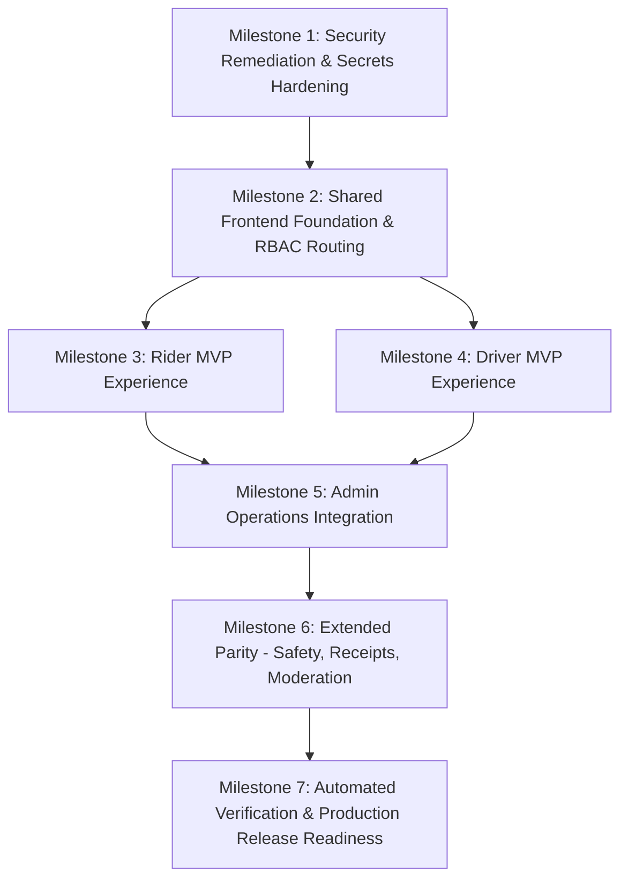

# LEXOR — Frontend Implementation Plan & Engineering Roadmap

## 1. Plan Overview & Objectives
This document defines the architectural strategy, phase milestones, dependency graph, and exact implementation sequence for expanding the **LEXOR** frontend into an enterprise-grade, commercial ride-hailing platform with **Uber functional parity**.

### Core Architecture Principles:
1. **Single Monorepo SPA with Role-Segregated Spaces**:
   - `/rider/*`: Rider Experience (mobile-first, reactive map, dynamic fare calculation, instant dispatch, live tracking, receipts, ratings, safety).
   - `/driver/*`: Driver Experience (onboarding checklist, KYC uploads, duty toggle, live GPS beacon, incoming offers, trip lifecycle with OTP start, earnings dashboard).
   - `/admin/*`: Operations HQ (Executive Overview, Live Dispatch Console, KYC Moderation, Vehicle Fleet, Payments/Refunds, Health Monitor, Audit Logs).
2. **Unified Session & RBAC Route Guards**:
   - `AuthContext` managing authentication state, token refresh, and role enforcement (`ROLE_RIDER`, `ROLE_DRIVER`, `ROLE_ADMIN`).
   - Unauthenticated users redirected to `/login` with return destination preservation.
   - Cross-role protection with user-friendly unauthorized views.
3. **Hardened Security & Zero Mock Production Fallbacks**:
   - Elimination of `mock-admin-token-role-admin` fallback from all production code paths.
   - Fail-secure startup enforcement for JWT secrets (>= 32 chars) across all .NET and Spring Boot services.
4. **Resilient API Client Layer**:
   - Centralized Axios/fetch abstraction with configurable base URL (`/api/v1`).
   - Typed request/response models mirroring actual Spring Boot and .NET microservices.
   - Correlation ID propagation (`X-Correlation-Id`), request timeouts, and normalized error responses.
5. **No Mock Data Presented as Live Production Metrics**:
   - When external provider credentials (e.g. live Google Maps, Twilio SMS) are unavailable, UI gracefully indicates provider configuration requirements without fabricating artificial tracking coordinates.

---

## 2. Milestone Breakdown & Delivery Sequence

### Milestone 1 — Security Remediation & Cryptographic Audit
- **Goal**: Eliminate hardcoded JWT signing keys, remove mock token fallbacks in frontend API client, correct tracked configuration files, and establish fail-secure startup rules.
- **Tasks**:
  1. Audit and remove hardcoded fallback secrets in .NET services (`ride-request-service`, `booking-service`, `driver-matching-service`, `payment-service`).
  2. Enforce fail-secure startup in .NET (`InvalidOperationException` if JWT secret is missing or < 32 characters in non-testing environments).
  3. Remove `mock-admin-token-role-admin` default fallback in `frontend/src/services/api.ts`.
  4. Redact committed placeholder API keys from `appsettings.json` and property files.
  5. Add automated unit regression tests verifying fail-secure behavior on invalid or missing tokens.
- **Dependencies**: None.

### Milestone 2 — Shared Frontend Foundation & RBAC Routing
- **Goal**: Implement typed API client layer, authentication context, role-based route guards, and responsive layout primitives preserving all existing Admin views.
- **Tasks**:
  1. Build `AuthContext` and custom hook `useAuth()` supporting login, registration, logout, and token refresh.
  2. Implement `ProtectedRoute` with role checking (`ROLE_RIDER`, `ROLE_DRIVER`, `ROLE_ADMIN`).
  3. Implement unified role-aware navigation bar and responsive shell supporting desktop and mobile screens.
  4. Build interactive vector map component with Leaflet / SVG geometry engine, GPS location pinpointing, and route polyline preview.
  5. Build reusable form controls, modal dialogs, status badges, and toast notification alerts.
- **Dependencies**: Milestone 1.

### Milestone 3 — Rider MVP Experience
- **Goal**: Deliver a complete end-to-end rider booking flow connected to real backend microservices.
- **Tasks**:
  1. **Authentication & Profile**: Registration (`POST /api/v1/auth/register`), Login (`POST /api/v1/auth/login`), profile viewing and address editing (`GET/PUT /api/v1/users/me`).
  2. **Location Discovery & Map**: Geolocation permission request, address autocomplete with OpenStreetMap/Mapbox provider abstraction, interactive pickup/drop map markers.
  3. **Categories & Fare Estimates**: Fetch active tiers from `ride-type-service` (`GET /api/v1/ride-types`), calculate dynamic fare estimates (base + per-km + per-min + tax) via `POST /api/v1/ride-requests`.
  4. **Ride Request & Status**: Instant request submission, real-time status polling / SSE stream, cancellation modal (`PATCH /api/v1/ride-requests/{uuid}/cancel`).
  5. **Trip Execution**: Display matched driver details, vehicle registration, 4-digit start trip OTP, and destination progress view.
  6. **Payment & Receipts**: Payment method selector (`GET /api/v1/payments/methods`), Razorpay sandbox checkout (`POST /api/v1/payments`), detailed invoice view (`GET /api/v1/payments/me/{uuid}/receipt`).
  7. **Ratings & Feedback**: Post-trip 5-star rating and review submission (`POST /api/v1/feedback/rides/{rideUuid}/driver-rating`).
- **Dependencies**: Milestone 2, `auth-service`, `ride-type-service`, `ride-request-service`, `booking-service`, `payment-service`, `feedback-service`.

### Milestone 4 — Driver MVP Experience
- **Goal**: Deliver driver onboarding, vehicle assignment, duty status toggle, live ride offers, and active trip execution.
- **Tasks**:
  1. **Onboarding & KYC**: Step-by-step checklist (`GET /api/v1/drivers/me/onboarding`), license & identity document upload (`POST /api/v1/drivers/me/documents`), resubmission workflow.
  2. **Vehicle Management**: Register commercial vehicle (`POST /api/v1/vehicles`), upload insurance and RC documents, view verification status.
  3. **Duty Availability**: Online / offline toggle (`PATCH /api/v1/drivers/me/availability`) with server-enforced document verification checks.
  4. **GPS Telemetry Beacon**: Automated periodic location updater (`PUT /api/v1/drivers/me/location`) tracking heading and coordinates.
  5. **Incoming Ride Offers**: Real-time offer modal with pickup distance, estimated trip duration, estimated earnings, and countdown timer (`POST /{uuid}/accept`, `POST /{uuid}/decline`).
  6. **Trip Lifecycle Console**:
     - Navigation to pickup
     - Arrival button (`POST /{uuid}/arrived`)
     - Start trip OTP verification modal (`POST /{uuid}/start`)
     - Complete trip button with final distance recording (`POST /{uuid}/complete`)
     - In-person cash collection confirmation (`POST /api/v1/driver/payments/{uuid}/cash-collection`)
  7. **Earnings & Performance**: Daily and weekly earnings summary with trip-by-trip breakdown and rating metrics (`GET /api/v1/drivers/me/rating-summary`).
- **Dependencies**: Milestone 2, `driver-service`, `vehicle-service`, `driver-matching-service`, `booking-service`, `payment-service`.

### Milestone 5 — Admin & Operations Dashboard Completion
- **Goal**: Validate and enhance existing 12 Admin views with live API connectivity, error boundaries, and operational actions.
- **Tasks**:
  1. Verify live API wiring for `OverviewView`, `LiveOpsView`, `DriversView`, `VehiclesView`, `PaymentsRevenueView`, `FeedbackModerationView`, `ReportsAnalyticsView`, `ServiceHealthView`, `AuditLogsView`, `SettingsView`.
  2. Connect administrative document verification decisions (`PATCH /driver-documents/{id}/status`, `PATCH /vehicles/{uuid}/verification`).
  3. Connect financial refund approvals (`POST /api/v1/admin/payments/{uuid}/refund`).
  4. Connect AI feedback moderation actions (`POST /api/v1/admin/feedback/{uuid}/moderation`).
  5. Connect emergency platform ride cancellation (`POST /api/v1/admin/operations/emergency-cancel-ride`).
- **Dependencies**: Milestones 2, 3, 4, `admin-operations-service`.

### Milestone 6 — Extended Feature Parity & Safety
- **Goal**: Add advanced commercial capabilities including safety tools, scheduled rides, and disputes.
- **Tasks**:
  1. Accessible Safety Center with one-touch emergency assistance (112), trusted contact management, and SOS event recording (`POST /api/v1/internal/notifications/events`).
  2. Secure trip sharing link generation for friends and family.
  3. Scheduled ride booking form supporting future date/time picker with validation.
  4. Lost item and dispute reporting workflow.
- **Dependencies**: Milestones 3, 4, 5.

### Milestone 7 — Verification & Release Readiness
- **Goal**: Comprehensive automated testing, production build validation, and documentation updates.
- **Tasks**:
  1. Run complete frontend test suite (`vitest run`).
  2. Run frontend production build (`tsc && vite build`).
  3. Run .NET microservice test suites (`dotnet test`).
  4. Verify no compilation or lint errors.
  5. Update `docs/UBER_FEATURE_PARITY_MATRIX.md` with final verification status.
  6. Provide detailed runbook of commands and environment variables required for deployment.
- **Dependencies**: All preceding milestones.

### Milestone 8 — Real-Time Streaming, Map Provider Abstraction & Production Integration (Phase 16)
- **Goal**: Establish authoritative real-time event streaming, eliminate simulated movement, enforce atomic offer concurrency, validate ride-start OTP attempt limits, verify HMAC payment webhooks, and implement open real road geometry.
- **Completed Components**:
  1. **Real-Time Event Stream (`realtimeService`)**:
     - Connected to `/api/v1/notifications/me/stream` (SSE) with Bearer token authentication.
     - Event pub/sub: `DRIVER_OFFER`, `BOOKING_ACCEPTED`, `DRIVER_ARRIVED`, `TRIP_STARTED`, `DRIVER_LOCATION_UPDATE`, `TRIP_COMPLETED`, `BOOKING_CANCELLED`, `PAYMENT_STATUS_UPDATE`.
     - Reconnection with exponential backoff and authoritative HTTP sync recovery (`api.getBookingDetails`).
     - Real-time connection status chip in UI (`Connected`, `Reconnecting`, `Fallback Polling`).
  2. **Authoritative Driver Geolocation Pipeline**:
     - Replaced simulated drift with `navigator.geolocation.watchPosition`.
     - Permission-aware tracking with 6-second throttling.
     - Backend coordinate boundary validation, in-memory cache, and MySQL write protection.
     - Freshness SLA indicators: Live (<30s), Stale (30s-120s), Offline (>120s).
  3. **Atomic Dispatch Offer Concurrency**:
     - `SemaphoreSlim` isolation per booking UUID in `BookingService.cs`.
     - Automatic expiry and double-claim prevention (`409 Conflict` / `403 Forbidden`).
     - Concurrency unit tests passing in `BookingServiceTests.cs`.
  4. **Strict OTP Security**:
     - Mandatory 4-digit OTP check before trip start.
     - Server-side BCrypt hash verification.
     - Maximum 3 failed attempts lockout (`409 Conflict`).
     - Plain OTP restricted to Rider only.
  5. **Map Provider Abstraction (`mapProvider.ts`)**:
     - OpenStreetMap tile layer and real road network geometry via OSRM.
     - Nominatim geocoding and reverse geocoding.
     - Compass bearing calculation.
     - Explicit disclosure badges: `[LIVE]` vs `[DEMO MODE]`.
  6. **Tokenized Payment Boundary (`paymentProvider.ts`)**:
     - Tokenized checkout handler for Razorpay / UPI without exposing secrets.
     - Backend webhook HMAC-SHA256 signature verification and event deduplication.
- **Verification Evidence**:
  - Frontend: 24 passing vitest tests (`npm test`).
  - Frontend: 0 errors on production build (`npm run build`).
  - Backend: 161 passing .NET unit/integration tests (`dotnet test`).

