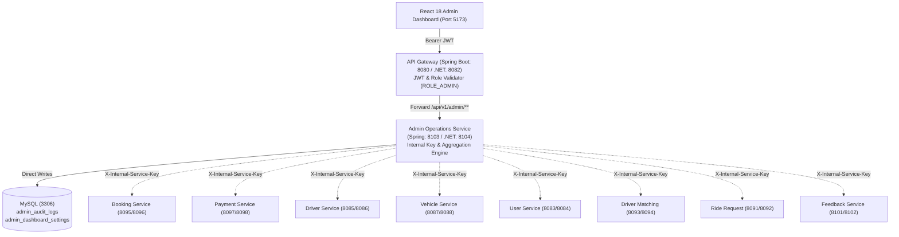

# LEXOR Phase 14 — Enterprise Admin & Operations Dashboard

## Executive Overview
Phase 14 establishes **LEXOR Enterprise Operations Console**, a centralized, data-driven, and secure administrative command center. Built across both backend microservice ecosystems (Spring Boot Java 21 on Port 8103 and .NET 9 C# 13 on Port 8104) and a React 18 + TypeScript + Vite frontend (`frontend/`), the system provides operations leaders with visibility, telemetry, governance, and audit trails for real-time ride dispatch, fleet management, financial reconciliation, and platform health.

---

## Architecture & Integration Design



### Port Allocations
| Stack | Service | Port | Protocols | Role |
| :--- | :--- | :--- | :--- | :--- |
| **Spring Boot** | `api-gateway` | 8080 | HTTP, Actuator | Entrypoint |
| **Spring Boot** | `admin-operations-service` | 8103 | REST, Actuator | Aggregation & Audit |
| **.NET 9** | `ApiGateway` | 8082 | HTTP, YARP Proxy | Entrypoint |
| **.NET 9** | `AdminOperationsService` | 8104 | REST, Health | Aggregation & Audit |
| **Frontend** | `lexor-admin-dashboard` | 5173 | HTTP | React 18 Admin UI |

---

## Database Migrations

### Migration `V12__admin_operations_service_additive.sql`
- **Location:** `database/mysql/migrations/V12__admin_operations_service_additive.sql`
- **Tables Created:**
  1. `admin_audit_logs`: Persists administrator user UUID, privileged actions (`EMERGENCY_RIDE_CANCEL`, `SUSPEND_DRIVER`, `VERIFY_DRIVER`, `APPROVE_VEHICLE`, etc.), resource type and UUID, IP address, status, and mandatory justification.
  2. `admin_dashboard_settings`: Dynamic operational tuning parameters including live polling intervals, surge thresholds, and driver deficit limits.
- **Application Status:** **Not automatically applied** per repository safety rules.
- **Manual Application Command:**
  ```bash
  mysql -u root -p lexor_db < database/mysql/migrations/V12__admin_operations_service_additive.sql
  ```

---

## Authoritative Metric Definitions

| Metric | Source Service | Timezone | Computation & Deduplication Rule |
| :--- | :--- | :--- | :--- |
| **Total Rides** | `booking-service` | UTC | Total booking records across non-purged states. |
| **Completed Rides** | `booking-service` | UTC | Bookings reaching terminal status `COMPLETED`. |
| **Cancelled Rides** | `booking-service` | UTC | Bookings in `CANCELLED_BY_RIDER`, `CANCELLED_BY_DRIVER`, `CANCELLED_BY_ADMIN`, or `EXPIRED`. |
| **Active Rides** | `booking-service` | UTC | Bookings in `CONFIRMED`, `ACCEPTED`, `ARRIVED`, or `IN_PROGRESS`. |
| **Pending Requests** | `ride-request-service` | UTC | Active ride requests awaiting driver dispatch. |
| **Online Drivers** | `driver-service` | UTC | Drivers verified and currently marked `isAvailable = true`. |
| **In-Trip Drivers** | `driver-service` | UTC | Drivers actively engaged in trips. |
| **Pending KYC** | `driver-service` | UTC | Driver profiles with `verificationStatus = PENDING`. |
| **Gross Booking Value** | `booking-service` | UTC | Sum of `fareAmount` across verified completed trips. |
| **Collections** | `payment-service` | UTC | Sum of successful transactions (`status = COMPLETED`). |
| **Disbursed Refunds** | `payment-service` | UTC | Sum of refund disbursements (`status = REFUNDED`). |
| **Platform Commission**| `payment-service` | UTC | Retained platform share (standard 20% commission). |
| **Average Rating** | `feedback-service` | UTC | Half-up arithmetic mean of verified reviews (`status = VISIBLE`). |
| **Moderation Queue** | `feedback-service` | UTC | Total reviews flagged with `moderationStatus = UNDER_REVIEW`. |

---

## Security & Authorization Enforcement

1. **Gateway Boundary:** All `/api/v1/admin/**` routes require JWT authentication with `ROLE_ADMIN`. Non-admin requests receive HTTP 403 Forbidden.
2. **Service Layer Authorization:** Both Spring Boot and .NET 9 services validate `@PreAuthorize("hasRole('ROLE_ADMIN')")` or `[Authorize(Roles = "ROLE_ADMIN")]` independently of the gateway.
3. **Internal Key Defense:** Cross-service calls use the `X-Internal-Service-Key` header with internal secrets configured via environment variables.
4. **Mandatory Audit Logging:** Every consequential action (cancellations, suspensions, document verifications, settings changes) requires an administrator justification reason, recorded immutably in `admin_audit_logs`.

---

## API Endpoints Reference

### Executive Overview & Live Operations
- `GET /api/v1/admin/operations/overview?timeRange={TODAY|7D|30D|90D|CUSTOM}&startDate=&endDate=`
- `GET /api/v1/admin/operations/live-snapshot`
- `POST /api/v1/admin/operations/emergency-cancel-ride` — Payload: `{ "bookingUuid": "...", "reason": "..." }`

### Platform Analytics & Reporting
- `GET /api/v1/admin/analytics/trends?timeRange={7D|30D|90D}`
- `GET /api/v1/admin/analytics/export/csv?reportType={RIDES|PAYMENTS|DRIVERS}&timeRange=7D`

### Service Health Probes
- `GET /api/v1/admin/health-monitor`

### Audit Trail & Settings
- `GET /api/v1/admin/audit-logs?page=0&size=20&action=`
- `POST /api/v1/admin/audit-logs` — Payload: `{ "action": "...", "resourceType": "...", "resourceUuid": "...", "reason": "..." }`
- `GET /api/v1/admin/audit-logs/settings`
- `PUT /api/v1/admin/audit-logs/settings` — Payload: `{ "settingKey": "...", "settingValue": "...", "description": "..." }`

---

## Local Startup Instructions

### 1. Spring Boot Admin Operations Service (Port 8103)
```bash
cd backend/springboot/admin-operations-service
mvn spring-boot:run
```

### 2. .NET 9 Admin Operations Service (Port 8104)
```bash
cd backend/dotnet/admin-operations-service
dotnet run
```

### 3. Frontend React Dashboard (Port 5173)
```bash
cd frontend
npm install
npm run dev
```
Access dashboard at `http://localhost:5173`.
