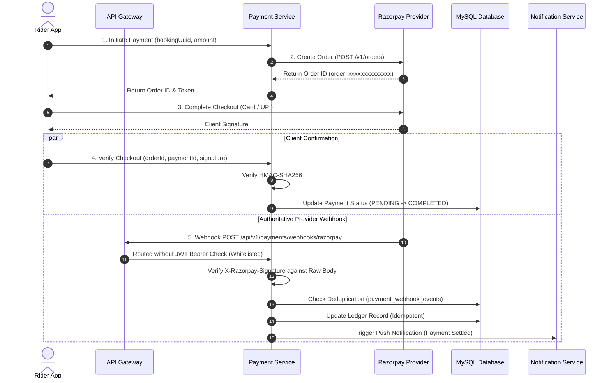

# LEXOR — Provider Webhooks & Asynchronous Event Processing

## 1. Webhook Ingress Architecture & Security Boundaries

In modern ride-hailing and financial systems, client-side redirects can be manipulated, dropped, or delayed due to network instability. **Provider webhooks** serve as the authoritative source of truth for payment settlements, refunds, and dispute transitions.



---

## 2. Inbound Webhook Endpoints & Gateway Whitelisting

### Webhook Endpoint Contract
- **HTTP Method**: `POST`
- **Path**: `/api/v1/payments/webhooks/{provider}` (e.g., `/api/v1/payments/webhooks/razorpay`)
- **Headers**:
  - `Content-Type: application/json`
  - `X-Razorpay-Signature: <hmac_sha256_hex>` (for Razorpay)
  - `X-Correlation-Id: <uuid>` (optional tracking header)

### API Gateway Whitelist Configuration
Because webhook requests originate from external provider servers rather than authenticated Lexor users, they do **not** contain JWT Bearer tokens. Both Lexor API Gateways explicitly whitelist this path from JWT inspection:

1. **Spring Cloud Gateway (`JwtAuthenticationGatewayFilter.java`)**:
   ```java
   private boolean isPublicEndpoint(String path) {
       return path.startsWith("/api/v1/auth/")
           || path.startsWith("/api/v1/payments/webhooks/")
           || path.startsWith("/api/v1/payments/methods");
   }
   ```

2. **.NET API Gateway (`JwtAuthenticationMiddleware.cs`)**:
   ```csharp
   private static bool IsPublicEndpoint(string path)
   {
       return path.StartsWith("/api/v1/auth/", StringComparison.OrdinalIgnoreCase)
           || path.StartsWith("/api/v1/payments/webhooks/", StringComparison.OrdinalIgnoreCase);
   }
   ```

---

## 3. Cryptographic Signature Verification

Razorpay authenticates webhooks by computing an HMAC-SHA256 hash of the **raw request payload body** using the shared webhook secret:

$$\text{Signature} = \text{HMAC-SHA256}(\text{RawBodyBytes}, \text{WebhookSecret})$$

### Implementation Details:
- **Spring Boot (`RazorpayPaymentProvider.java`)**:
  Uses `Mac.getInstance("HmacSHA256")` initialized with `SecretKeySpec(secret.getBytes(UTF_8), "HmacSHA256")`. The hex-encoded output is compared with `X-Razorpay-Signature` using constant-time equality check (`MessageDigest.isEqual`) to protect against timing attacks.
- **.NET (`RazorpayPaymentProvider.cs`)**:
  Uses `System.Security.Cryptography.HMACSHA256` initialized with UTF-8 secret bytes. Constant-time comparison is enforced using `CryptographicOperations.FixedTimeEquals`.

---

## 4. Idempotency & Duplicate Prevention

External payment providers guarantee *at least once* delivery, meaning the same webhook may be sent multiple times due to transient network timeouts. Lexor implements two-layer deduplication:

1. **Database Uniqueness Constraint**:
   The table `payment_webhook_events` maintains a unique composite constraint:
   ```sql
   UNIQUE KEY uq_webhook_provider_event (provider, provider_event_id);
   ```
2. **Service Layer Deduplication Check**:
   Before processing, the payment service queries `payment_webhook_events`:
   - If `provider_event_id` already exists and status is `PROCESSED`, the handler immediately returns HTTP `200 OK` without re-processing business logic or creating duplicate ledger entries.
   - If not found, a record is inserted in state `RECEIVED`, processed atomically in a database transaction, and updated to `PROCESSED`.

---

## 5. Supported Provider Webhook Events

| Razorpay Event Name | Platform Action | Ledger Transition | Notification Triggered |
| :--- | :--- | :--- | :--- |
| `order.paid` | Confirms full order settlement | `PENDING` -> `COMPLETED` | Push Notification to Rider & Driver |
| `payment.authorized` | Transaction authorized by issuing bank | `PENDING` -> `AUTHORIZED` | In-app status update |
| `payment.captured` | Funds captured by merchant | `AUTHORIZED` -> `COMPLETED` | Receipt generated |
| `payment.failed` | Card declined or UPI timeout | `PENDING` -> `FAILED` | Push Notification: Payment Failed (Prompt retry) |
| `refund.created` | Refund requested by admin or policy | `COMPLETED` -> `REFUND_PENDING` | Admin audit log entry |
| `refund.processed` | Funds returned to rider source account | `REFUND_PENDING` -> `REFUNDED` | Push & SMS: Refund Processed |

---

## 6. Out-of-Order & Delayed Event Reconciliation

In distributed environments, network latency may cause `payment.captured` to arrive before `payment.authorized`, or after a rider has already completed checkout via frontend redirect:

1. **State Machine Monotonicity**:
   Payment states progress monotonically:
   $$\text{PENDING} \longrightarrow \text{AUTHORIZED} \longrightarrow \text{COMPLETED} \longrightarrow \text{REFUNDED}$$
   An incoming `payment.authorized` event will not overwrite a record that is already `COMPLETED`.
2. **Administrative Reconciliation Tool**:
   Administrators can open the **Admin Payments & Revenue View** (`/admin/payments`), inspect provider reference IDs (`order_id`, `payment_id`), and trigger explicit cryptographic reconciliation against the provider's authoritative ledger. Every manual reconciliation generates an immutable audit record in `admin_audit_logs`.
