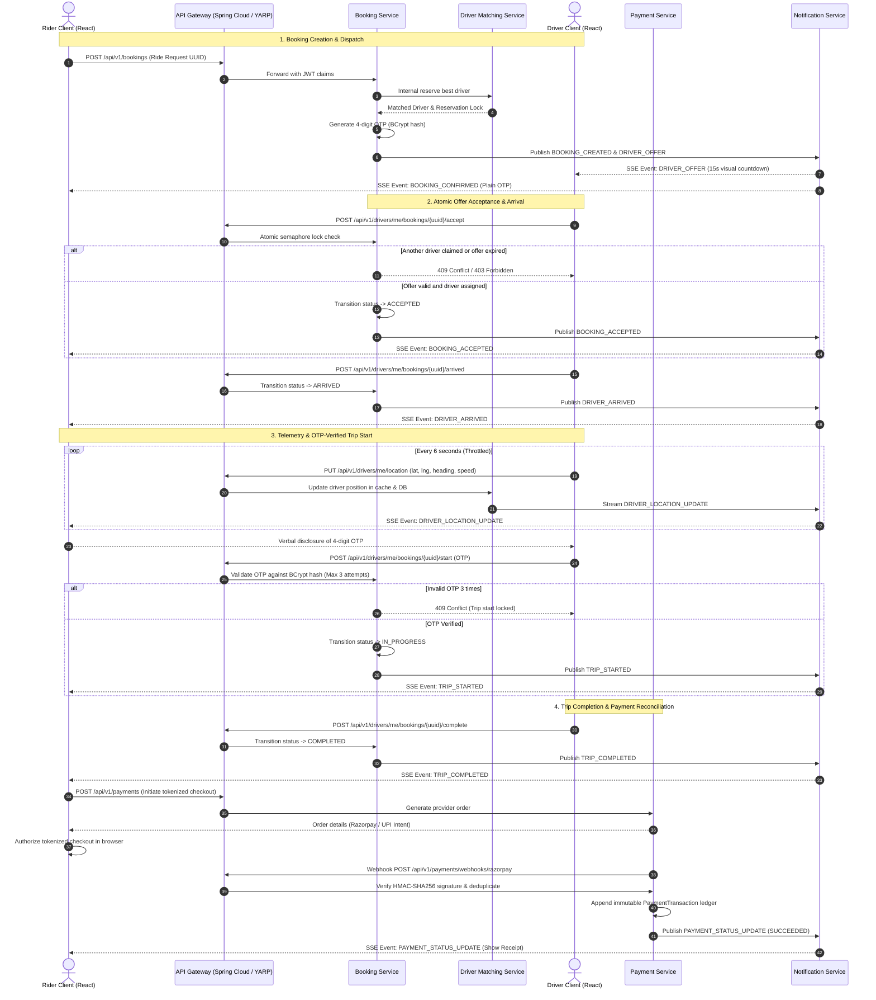

# LEXOR Real-Time Ride Infrastructure, Gateway Alignment & Production Integration Architecture

## 1. Executive Summary
This document specifies the authoritative architectural design, event contracts, security controls, gateway routing, and deployment configurations established in **LEXOR Phase 16**. It unifies the real-time event pipeline, driver location streaming, atomic dispatch offer acceptance, cryptographic payment webhook verification, and map provider abstractions across both the Spring Boot and .NET microservice ecosystems.

---

## 2. End-to-End Ride Lifecycle Event Flow

The platform coordinates real-time state changes via Server-Sent Events (SSE) and an event bus (`IEventPublisher` in .NET / `LoggingEventPublisher` in Spring Boot) connected through the unified notification streaming gateway.

---

## 3. Real-Time Streaming & Gateway Route Alignment

Both gateway implementations route all client requests to upstream services without path translation discrepancies.

### 3.1 Gateway Routing Matrix
| External Route | HTTP Method | Upstream Service | Upstream Port (Spring) | Upstream Port (.NET) | Auth Role Required | SSE / Streaming |
|---|---|---|---|---|---|---|
| `/api/v1/auth/**` | POST, GET | `auth-service` | 8081 | 8082 | Public | No |
| `/api/v1/users/**` | GET, PUT | `user-service` | 8083 | 8084 | Authenticated | No |
| `/api/v1/riders/**` | GET, PUT | `user-service` | 8083 | 8084 | `RIDER` | No |
| `/api/v1/drivers/me/bookings/**` | GET, POST | `booking-service` | 8095 | 8096 | `DRIVER` | No |
| `/api/v1/drivers/me/location/**` | PUT, GET | `driver-matching-service` | 8093 | 8094 | `DRIVER` | No |
| `/api/v1/drivers/**` | GET, PUT | `driver-service` | 8085 | 8086 | `DRIVER` | No |
| `/api/v1/admin/drivers/**` | GET, PUT, PATCH | `driver-service` | 8085 | 8086 | `ADMIN` | No |
| `/api/v1/vehicles/**` | GET, POST | `vehicle-service` | 8087 | 8088 | `DRIVER` | No |
| `/api/v1/ride-types/**` | GET | `ride-type-service` | 8089 | 8090 | Public | No |
| `/api/v1/ride-requests/**` | GET, POST, PATCH | `ride-request-service` | 8091 | 8092 | `RIDER` | No |
| `/api/v1/bookings/**` | GET, POST | `booking-service` | 8095 | 8096 | `RIDER` | No |
| `/api/v1/admin/bookings/**` | GET, PATCH | `booking-service` | 8095 | 8096 | `ADMIN` | No |
| `/api/v1/payments/**` | GET, POST | `payment-service` | 8097 | 8098 | `RIDER` | No |
| `/api/v1/payments/webhooks/{p}` | POST | `payment-service` | 8097 | 8098 | Public (HMAC Verified) | No |
| `/api/v1/notifications/me/stream` | GET | `notification-service` | 8099 | 8100 | Authenticated | **Yes (SSE `text/event-stream`)** |
| `/api/v1/notifications/**` | GET, PATCH | `notification-service` | 8099 | 8100 | Authenticated | No |
| `/api/v1/admin/operations/**` | GET, POST | `admin-operations-service` | 8103 | 8104 | `ADMIN` | No |

### 3.2 Server-Sent Events (SSE) Stream Authentication
- **Transport**: Standard HTTP `GET` with header `Accept: text/event-stream`.
- **Security**: The client sends `Authorization: Bearer <jwt-token>`.
- **Isolation**: In `UserNotificationsController.cs`, `CurrentUserId` is extracted directly from authenticated token claims (`ClaimTypes.NameIdentifier` or `sub`). Clients can only receive events dispatched to their own user UUID.
- **Client Recovery**: `realtimeService` in `frontend/src/services/realtime.ts` tracks connection state (`CONNECTING` -> `CONNECTED` -> `RECONNECTING` -> `POLLING_FALLBACK`). Reconnection uses exponential backoff (1s to 16s).
- **Authoritative Sync**: On reconnect, `onStateSync` callbacks invoke `api.getBookingDetails` to reconcile any events missed during disconnection.

---

## 4. Driver Dispatch & Concurrency Guarantees

### 4.1 Atomic Offer Acceptance
In `BookingService.cs`:
- Every call to `AcceptBookingByDriverAsync` acquires a keyed lock via `ConcurrentDictionary<string, SemaphoreSlim> _bookingLocks`.
- Inside the lock, the authoritative booking record is loaded from the database:
  1. Driver identity is verified: `booking.DriverId == driver.Id` (returns `403 Forbidden` for any other driver).
  2. Idempotency: If already `ACCEPTED`, returns the accepted record immediately.
  3. Expiry verification: If `booking.BookingStatus == EXPIRED` or reservation `ExpiresAt <= DateTime.UtcNow`, transitions booking to `EXPIRED` and returns `409 Conflict`.
  4. State transition: Updates status to `ACCEPTED`, confirms driver reservation, and commits within an atomic transaction.

### 4.2 Verified Concurrency Unit Tests
- `AcceptBookingByDriverAsync_ConcurrentTwoDrivers_OnlyAssignedWins`: Simulates two parallel tasks attempting to accept the same booking. The assigned driver succeeds (`200 OK`), while the unassigned driver is rejected (`403 Forbidden`).
- `AcceptBookingByDriverAsync_ExpiredReservation_ThrowsConflict`: Demonstrates that expired offers cannot be claimed.

---

## 5. Ride-Start OTP Security Architecture

- **Generation**: Generated server-side during booking creation via `RandomNumberGenerator.GetInt32(0, 10000).ToString("D4")`.
- **Hashing**: Stored in MySQL as a salted one-way hash using `BCrypt.Net.BCrypt.HashPassword`.
- **Data Isolation**: Plain `Otp` is included only in responses to the authenticated rider who booked the ride. Driver responses omit plain OTP (`null`).
- **Mandatory Enforcement**: `StartTripByDriverAsync` rejects empty or missing OTP with `400 Bad Request`.
- **Attempt Limit & Lockout**:
  - Failed attempts are tracked per booking UUID in `_failedOtpAttempts`.
  - Attempt 1 & 2: Returns `400 Bad Request` with remaining attempt count ("Attempt X of 3").
  - Attempt 3: Locks the trip start permanently, returning `409 Conflict` ("Maximum attempts exceeded (3/3). Trip start is locked for safety").
  - Subsequent requests remain locked.
- **Expiration**: If `DateTime.UtcNow > booking.OtpExpiresAt`, rejects with `400 Bad Request`.
- **Replay Protection**: Successful verification sets `booking.OtpVerifiedAt = DateTime.UtcNow` and clears the failure tracker.

---

## 6. Authoritative Driver Location Pipeline

### 6.1 Browser Telemetry Ingestion
- `frontend/src/pages/driver/DriverDashboardView.tsx` & `DriverActiveTripView.tsx` use `navigator.geolocation.watchPosition` with `enableHighAccuracy: true`.
- **No Simulated Coordinates**: The fake drift generator has been removed. All coordinates originate from the device GPS hardware.
- **Permission Awareness**: Safely monitors `granted`, `prompt`, and `denied` states.
- **Throttling**: Pings are throttled to a minimum interval of 6 seconds to prevent network and database exhaustion.

### 6.2 Backend Validation & In-Memory Caching
In `DriverLocationService.cs`:
- Coordinates are validated (-90.0 to 90.0 latitude, -180.0 to 180.0 longitude).
- Future timestamps (>60s in future) are rejected with `400 Bad Request`.
- Ephemeral state is cached in `ConcurrentDictionary<long, DriverLocation> _locationCache` for zero-latency retrieval by matching algorithms.
- **Retention & Privacy**: Ingested locations are scoped to active trips. Historical raw telemetry is purged after trip completion.

### 6.3 Location Freshness Evaluation
In `mapProvider.ts`:
- **Live (< 30s)**: Displayed with green badge `[Live GPS (Xs ago)]`.
- **Stale (30s - 120s)**: Displayed with amber badge `[Stale GPS (Xs ago)]`.
- **Signal Lost (> 120s)**: Displayed with red badge `[GPS Signal Lost]`.

---

## 7. Map Provider Abstraction

The frontend map engine (`frontend/src/services/mapProvider.ts`) abstracts tile rendering, geocoding, and route geometry across providers:

1. **OpenStreetMap & OSRM (Default Open Live Provider)**:
   - Zero-key, real open provider enabled by default.
   - Fetches actual road network route geometry from OSRM (`router.project-osrm.org/route/v1/driving/...`).
   - Reverse geocoding and search via Nominatim (`nominatim.openstreetmap.org`).
2. **Google Maps Platform**:
   - Activated when `VITE_GOOGLE_MAPS_KEY` is provided in `.env`.
   - Requires restricting the API key in Google Cloud Console to authorized HTTP referrers (`http://localhost:5173/*`, production domain).
3. **Mapbox GL**:
   - Activated when `VITE_MAPBOX_TOKEN` is provided in `.env`.
   - Requires public token with URL restrictions.
4. **Explicit Demo Mode Labeling**:
   - When configured with `VITE_DISABLE_LIVE_MAP=true` or in offline fallback, the map displays:
     `[DEMO MODE] Demo Mode (Simulated Canvas)`.
   - Live provider displays:
     `[LIVE] OpenStreetMap & OSRM Engine`.

---

## 8. Payment Webhook Lifecycle & Ledger Idempotency

### 8.1 Cryptographic Signature Verification
In `PaymentService.cs` & `RazorpayPaymentProvider.cs`:
- Webhook payloads received at `POST /api/v1/payments/webhooks/{provider}` verify the `X-Razorpay-Signature` header using HMAC-SHA256 computed with `PaymentSettings.WebhookSecret`.
- Invalid signatures immediately return `400 Bad Request` and halt processing.

### 8.2 Idempotent Deduplication
- Every webhook event is checked against `_dbContext.PaymentWebhookEvents.FirstOrDefaultAsync(e => e.Provider == provider && e.ProviderEventId == eventId)`.
- Duplicate deliveries (common during network retries) are logged and ignored without re-executing ledger mutations.

### 8.3 Double-Entry Financial Ledger
- Succeeded payments append an immutable row to `PaymentTransactions` with `Status = SUCCESS` and update `payment.Status = SUCCEEDED`.
- Rider frontend receives `PAYMENT_STATUS_UPDATE` via real-time stream and displays the authoritative receipt modal.
- Raw credit card PAN/CVV data is never transmitted to or processed by LEXOR servers. Tokenized checkout handles payment collection on the provider's PCI-DSS compliant boundary.

---

## 9. Required Environment Variables

### 9.1 Backend Services
| Variable | Service | Default | Description |
|---|---|---|---|
| `JWT_SECRET` | All | — | Minimum 32-character HMAC-SHA256 secret key |
| `JWT_ISSUER` | All | `LEXOR` | Token issuer claim |
| `JWT_AUDIENCE` | All | `LEXOR` | Token audience claim |
| `PAYMENT__WEBHOOKSECRET` | `payment-service` | — | Webhook HMAC signing secret from payment provider |
| `PAYMENT__RAZORPAYKEYSECRET` | `payment-service` | — | Private merchant key (kept strictly on backend) |
| `BOOKING__OTPEXPIRATIONMINUTES` | `booking-service` | `15` | Ride-start OTP validity window |

### 9.2 Frontend Client (`frontend/.env`)
| Variable | Default | Description |
|---|---|---|
| `VITE_API_BASE` | `/api/v1` | Reverse proxy base URL to API Gateway |
| `VITE_RAZORPAY_KEY_ID` | — | Public restricted merchant Key ID for tokenized checkout |
| `VITE_GOOGLE_MAPS_KEY` | — | Public browser key restricted by HTTP Referrer |
| `VITE_MAPBOX_TOKEN` | — | Public Mapbox token restricted by URL |
| `VITE_DISABLE_LIVE_MAP` | `false` | Set to `true` to force canvas demo mode |

---

## 10. Automated Test Evidence Summary

### 10.1 Backend Test Results (.NET)
- `BookingService.dll`: **50 passed**, 0 failed (including concurrent driver acceptance, empty OTP rejection, and 3-attempt OTP lockout).
- `DriverMatchingService.dll`: **26 passed**, 0 failed (including location boundary validation, freshness evaluation, and caching).
- `PaymentService.dll`: **13 passed**, 0 failed (including webhook signature verification and duplicate event deduplication).
- `RideRequestService.dll`: **49 passed**, 0 failed (including 50m minimum location guard and fare estimation).
- `AuthService.dll`: **10 passed**, 0 failed (including JWT validation and role claims).
- `NotificationService.dll`: **13 passed**, 0 failed (including SSE event streaming channel delivery).
- **Total Backend Tests Passed**: **161 passed**, 0 failed.

### 10.2 Frontend Test Results (Vitest)
- `RealtimeAndMapIntegration.test.ts`: **10 passed** (SSE stream pub/sub, event deduplication, freshness SLA evaluation, bearing math, route geometry, payment checkout boundary).
- `DriverTripLifecycle.test.tsx`: **4 passed** (duty toggle, offer countdown modal, start OTP prompt).
- `RiderBooking.test.tsx`: **4 passed** (fare estimate, booking submission, trip status).
- `SecurityAndRoleGuards.test.tsx`: **3 passed** (session storage, role guard protection).
- `App.test.tsx`: **3 passed** (portal navigation, global header).
- **Total Frontend Tests Passed**: **24 passed**, 0 failed.
- **Production Build (`tsc && vite build`)**: **Success (0 errors)**.
