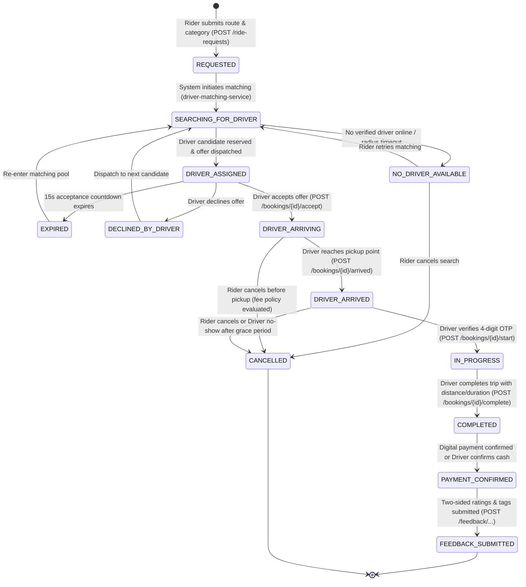
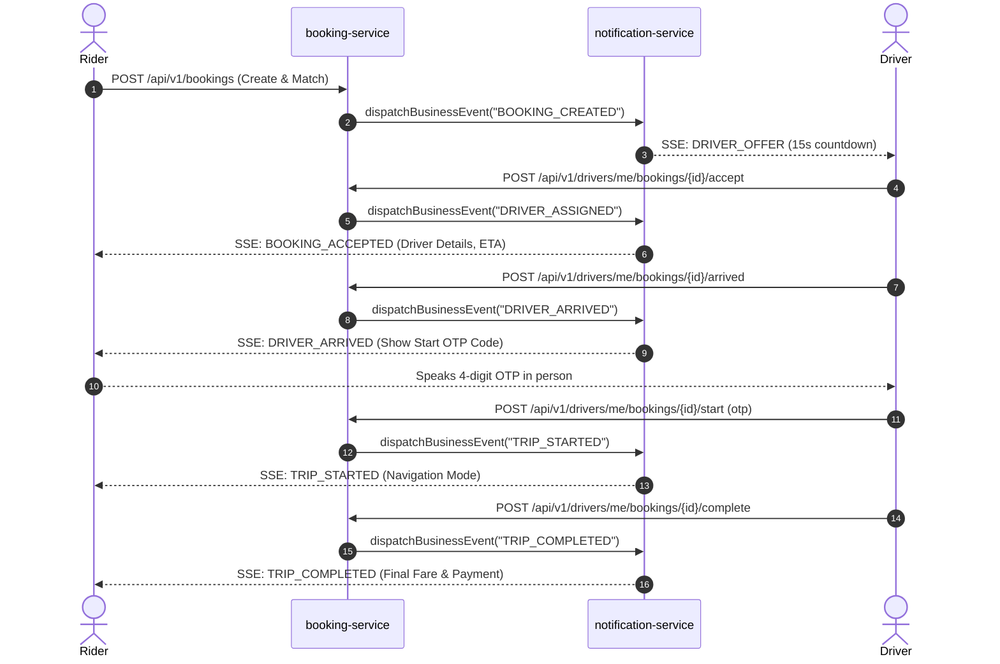

# LEXOR — End-to-End Ride Lifecycle & State Machine Architecture

## 1. Overview & System Scope
This document details the authoritative end-to-end ride lifecycle across the **LEXOR Smart Mobility Platform**, connecting:
- **Rider Experience**: Registration, route planning, fare estimation, booking dispatch, live driver tracking, start OTP display, payment receipt, and driver feedback.
- **Driver Partner Experience**: Onboarding verification, duty toggle, live GPS beacon, incoming offer modal with countdown, pickup navigation, OTP pickup verification, trip progress, completion, cash collection, and rider rating.
- **Admin Operations Console**: Live fleet telemetry, ride monitoring, emergency dispatch overrides, financial audit logs, and complaint investigation.
- **Backend Microservices**: Mirror architecture across Spring Boot 3.2.x (Java 21) and .NET 9.0 (`auth-service`, `user-service`, `driver-service`, `vehicle-service`, `ride-type-service`, `ride-request-service`, `driver-matching-service`, `booking-service`, `payment-service`, `notification-service`, `feedback-service`, and `admin-operations-service`).

---

## 2. Ride State Machine & Transition Rules

### State Definitions & Enums
The system maintains consistency across the MySQL schema (`schema.sql`), JPA entities (`Booking.java`, `Ride.java`), and EF Core models (`Booking.cs`, `Ride.cs`):

| Logical State | DB `BookingStatus` | DB `RideStatus` | Description |
| :--- | :--- | :--- | :--- |
| `REQUESTED` | `OFFERED` / `PENDING` | `REQUESTED` | Ride request created with pickup/destination coordinates and category. |
| `SEARCHING_FOR_DRIVER` | `OFFERED` | `SEARCHING_DRIVER` | Driver matching service evaluating online, verified drivers within radius. |
| `DRIVER_ASSIGNED` | `CONFIRMED` / `DRIVER_ASSIGNED` | `DRIVER_ASSIGNED` | Eligible driver reserved with optimistic concurrency lock; offer countdown running. |
| `DRIVER_ARRIVING` | `ACCEPTED` | `DRIVER_ARRIVING` | Driver accepted offer and is navigating towards rider pickup point. |
| `DRIVER_ARRIVED` | `ARRIVED` | `DRIVER_ARRIVED` | Driver reached pickup coordinate; wait timer initiated. |
| `IN_PROGRESS` | `IN_PROGRESS` | `TRIP_STARTED` | Driver verified 4-digit OTP; trip navigation active to destination. |
| `COMPLETED` | `COMPLETED` | `TRIP_COMPLETED` | Driver confirmed dropoff with recorded distance and duration metrics. |
| `PAYMENT_CONFIRMED` | `COMPLETED` | `PAYMENT_COMPLETED` | Digital capture verified or cash collected; invoice receipt generated. |
| `CANCELLED` | `CANCELLED_BY_RIDER` / `_DRIVER` / `_ADMIN` | `CANCELLED` | Trip terminated prior to OTP start. |
| `NO_DRIVER_AVAILABLE`| `EXPIRED` | `SEARCHING_DRIVER` | No eligible drivers responded or online in category. |

---

## 3. Strict Server-Side Transition Guards

To guarantee lifecycle integrity, the backend enforces the following invariant rules at the persistence and domain layer:

1. **OTP Verification Gate**:
   - A driver **cannot start a trip** without providing the rider's 4-digit OTP.
   - The plain OTP is generated at booking confirmation, transmitted strictly to the authenticated rider, and stored hashed using BCrypt (`otp_hash`).
   - Failed attempts increment an atomic counter. Exceeding **3 failed attempts** permanently locks the booking (`409 Conflict`) to prevent brute-force attacks.
2. **Terminal State Immutability**:
   - A `COMPLETED` trip cannot be restarted, arrived at, or accepted again.
   - A `CANCELLED` trip cannot be completed or started.
3. **Mid-Trip Cancellation Guard**:
   - Once a ride transitions to `IN_PROGRESS`, neither rider nor driver can unilaterally cancel the ride via standard cancellation APIs (`409 Conflict: Cannot cancel active journey in progress`). Only emergency Admin override (`/api/v1/admin/operations/emergency-cancel-ride`) can terminate an in-progress ride.
4. **Ownership & Driver Isolation**:
   - A driver can only accept, arrive, start, complete, or collect cash for trips assigned directly to their `driver_id`. Attempting to modify another driver's booking throws `403 Forbidden`.
   - A rider can only query details, cancel, or review bookings where `rider_id` equals the authenticated user.
5. **No Overlapping Active Journeys**:
   - A driver with an existing `IN_PROGRESS` or `ARRIVED` booking cannot be assigned to another trip. The matching query filters out busy drivers, and `BookingService` verifies `hasActiveBookingForDriver` before creating a booking.
6. **Eligibility Guard for Online Duty**:
   - Drivers cannot toggle online duty if their status is not `VERIFIED` or if they lack an approved, active vehicle in the system. The server rejects online duty requests with `400 Bad Request` or `403 Forbidden`.

---

## 4. Concurrency & Race-Condition Control

When multiple drivers receive offers or multiple riders book simultaneously:

1. **Driver Reservation Locking**:
   - When matching selects a candidate, an entry is inserted into `driver_reservations` with status `RESERVED` and a 5-minute sliding TTL.
   - If two matching cycles target the same driver simultaneously, unique constraints and transaction isolation (`SELECT ... FOR UPDATE` or EF Core transaction) ensure only one reservation succeeds; competing attempts receive `409 Conflict` and re-enter candidate evaluation.
2. **Atomic Driver Offer Acceptance**:
   - In .NET, a per-booking `SemaphoreSlim` lock guarantees atomic acceptance execution.
   - In Spring Boot, `@Transactional` with optimistic locking (`@Version`) or conditional status update (`UPDATE bookings SET booking_status = 'ACCEPTED' WHERE id = :id AND booking_status IN ('CONFIRMED', 'OFFERED')`) ensures only one driver can claim the booking.
3. **Idempotency Key Support**:
   - Both `POST /api/v1/bookings` and `POST /api/v1/payments` accept an `Idempotency-Key` header.
   - Duplicate requests with identical keys return the existing persisted entity rather than creating duplicates.

---

## 5. Booking-to-Notification Domain Event Flow

Lifecycle events trigger real-time updates and push notifications via `notification-service`:

---

## 6. Financial Settlement & Payment Integrity

1. **Authoritative Backend Pricing**:
   - Fares are calculated authoritatively on the backend (`BaseFare + (DistanceKm * PerKmRate) + (DurationMin * PerMinRate) * SurgeMultiplier + TaxAmount`).
   - The frontend never dictates the final fare amount.
2. **Cash vs. Digital Flows**:
   - **Cash Payment**: Driver collects currency in person at dropoff and triggers `POST /api/v1/driver/payments/{bookingUuid}/cash-collection`. The backend creates/updates the payment entity to `SUCCEEDED`, logs double-entry financial ledger entries (crediting platform commission liability to driver account, debiting driver cash retained), and releases the invoice receipt.
   - **Digital Payment (Razorpay/UPI)**: Order created via server-to-server Razorpay API. Frontend executes checkout via tokenized modal. Provider delivers HMAC-SHA256 signed webhook (`payment.captured`), which is cryptographically verified before marking payment `SUCCEEDED`.
3. **Receipt Generation**:
   - Available via `GET /api/v1/payments/me/{paymentOrBookingUuid}/receipt`.
   - Includes itemized fare components, taxes, driver payout, and platform fee.
